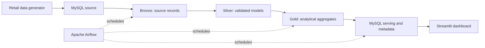

# RetailLake 360

RetailLake 360 is a sample retail analytics platform. It generates an OLTP-style retail dataset, processes it through a medallion pipeline that writes Parquet files, publishes analytical tables to MySQL, and presents the results in a Streamlit dashboard.

## Architecture



The MySQL instance contains separate `retaillake_source`, `retaillake_serving`, and `retaillake_metadata` databases. Airflow includes end-to-end and hourly sync DAGs. The hourly DAG records a checkpoint and runs the same ingestion, transformation, aggregation, and publishing stages. The standalone runner can execute the pipeline without Airflow.

## Features

- Synthetic retail source data for customers, products, stores, orders, and inventory.
- Bronze, Silver, and Gold processing with Pandas and Parquet storage through PyArrow.
- Silver-layer data quality checks and Gold analytical aggregates.
- MySQL serving tables, sync checkpoints, and pipeline audit records.
- A Streamlit dashboard with sales, customer, product, store, inventory, and pipeline views.
- Docker Compose configuration for MySQL, Airflow, and the dashboard.

## Technology

Python, Pandas, PyArrow, Parquet, MySQL 8.4, SQLAlchemy, PyMySQL, Apache Airflow, Streamlit, and Plotly.

## Project ownership and engineering approach

I am the owner and maintainer of RetailLake 360. My role is to shape the platform's architecture, integrate its data and orchestration layers, and document how to run and extend it. RetailLake 360 was developed with AI assistance. The original publication commit credited GitHub Copilot.

The system separates responsibilities across a simulated retail source in MySQL, a Bronze/Silver/Gold Parquet pipeline, MySQL serving and metadata databases, and a Streamlit analytics dashboard. Airflow provides scheduled end-to-end and hourly sync workflows, while a standalone runner supports execution without Airflow.

Key engineering decisions include:

- Keep source, analytical serving, and operational metadata in separate databases.
- Use Parquet-backed medallion layers to distinguish ingested records, validated transformations, and business aggregates.
- Publish Gold data to MySQL with repeatable upserts, and track checkpoints and pipeline activity in metadata.
- Support both scheduled orchestration and a direct runner so the pipeline can be exercised in different local workflows.
- Use Docker Compose for a reproducible local stack, with credentials supplied through environment configuration. The included setup is intended for local development, not as-is deployment to a shared environment.

## Getting started

### Docker Compose

Requirements: Docker with the Compose plugin.

1. Copy `.env.example` to `.env`.
2. Set each blank password to a unique, strong value. Keep the MySQL role passwords distinct.
3. Start the services:

   ```powershell
   docker compose up --build -d
   ```

4. Open the dashboard at <http://localhost:8501> or Airflow at <http://localhost:8080>. Sign in to Airflow using the username and password from `.env`.

The Compose file publishes MySQL on port 3306, the dashboard on 8501, and Airflow on 8080 to the host. This setup is intended for local development; apply appropriate network restrictions and deployment controls before using it in a shared environment.

MySQL's initialization scripts run only when its data volume is first created. If credentials are changed later, update the corresponding MySQL users deliberately; changing `.env` alone does not rotate existing database credentials.

### Local Python commands

Use Python 3.10 to match the provided Airflow image. The dependency set also includes PySpark and Delta Lake for the standalone session helper in `src/lakehouse/spark_session.py`.

```powershell
python -m venv .venv
.\.venv\Scripts\Activate.ps1
python -m pip install -r requirements.txt
Copy-Item .env.example .env
```

Set unique credentials in `.env`, then run:

```powershell
python -m pytest tests -v
python scripts/run_pipeline.py
streamlit run src/dashboard/app.py
```

The pipeline and dashboard require a reachable, initialized MySQL instance. To initialize MySQL schemas and users from a local environment, set the MySQL connection and credential variables in `.env`, start MySQL, and run:

```powershell
python scripts/setup_mysql.py
```

`scripts/verify_platform.py` performs platform-level checks and requires the services and database it exercises to be available.

## Repository layout

| Path | Purpose |
| --- | --- |
| `config/` | Environment-based settings and SQLAlchemy connection setup |
| `docker/mysql/` | MySQL configuration, schemas, and initialization scripts |
| `src/source_simulation/` | Synthetic retail data generation and seeding |
| `src/lakehouse/` | Bronze ingestion and Silver/Gold transformations |
| `src/serving/` | Publishing, checkpoints, query analysis, and audit logging |
| `src/dashboard/` | Streamlit application, queries, and visual components |
| `dags/` | Airflow end-to-end and hourly sync workflows |
| `scripts/` | Pipeline, database setup, startup, and verification utilities |
| `tests/` | Automated tests |
| `docs/` | Architecture, lineage, security, and performance notes |

## Documentation

- [Architecture](docs/ARCHITECTURE.md)
- [Data lineage](docs/DATA_LINEAGE.md)
- [Security](docs/SECURITY.md)
- [Performance configuration](docs/PERFORMANCE.md)

## License

This project is distributed under the MIT License. See [LICENSE](LICENSE).
