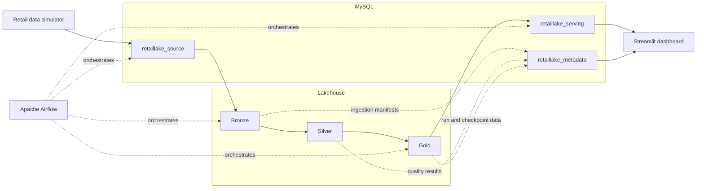

# Architecture

RetailLake 360 separates its sample retail source, analytical serving tables, and operational metadata into three MySQL databases. The Bronze, Silver, and Gold pipeline uses Pandas for processing and PyArrow for Parquet storage.

## Components

- **Source database:** simulated retail entities and transactions in `retaillake_source`.
- **Lakehouse:** Parquet files in the Bronze, Silver, and Gold layers. Bronze retains ingested source records. Silver applies transformations and quality checks. Gold contains business aggregates.
- **Serving database:** published Gold tables and views in `retaillake_serving`. The publisher uses MySQL upserts to support repeatable publishing.
- **Metadata database:** pipeline runs, checkpoints, quality results, and ingestion metadata in `retaillake_metadata`.
- **Orchestration:** Airflow defines a daily end-to-end workflow and an hourly sync. The hourly DAG checks the recorded watermark, processes the source tables, and updates the checkpoint.
- **Dashboard:** Streamlit reads serving data and selected pipeline metadata.

## Runtime options

`scripts/run_pipeline.py` runs the main workflow directly. `scripts/setup_mysql.py` initializes databases, schemas, users, and grants against a running MySQL server. The Compose configuration provides the database, Airflow services, and dashboard for local use.
