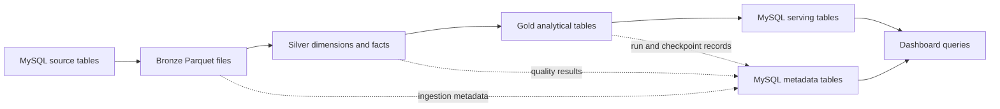

# Data lineage

The pipeline processes synthetic retail records with Pandas and stores Bronze, Silver, and Gold datasets as Parquet files through PyArrow. The publisher loads the Gold datasets into MySQL.

## Layer responsibilities

- **Source:** customers, stores, products, orders, order items, and inventory.
- **Bronze:** source-shaped data with ingestion metadata, including the run identifier and source table.
- **Silver:** cleaned and modeled dimensions and facts. The transformation code checks data quality and relationships among the source entities.
- **Gold:** aggregated sales, customer, product, store, and inventory datasets for analysis.
- **Serving:** published copies of Gold datasets and database views consumed by dashboard queries.
- **Metadata:** run records, checkpoints, ingestion manifests, and quality results used for operational visibility.

The implementation for each step is under `src/lakehouse/`, with MySQL publishing and metadata handling under `src/serving/`.
